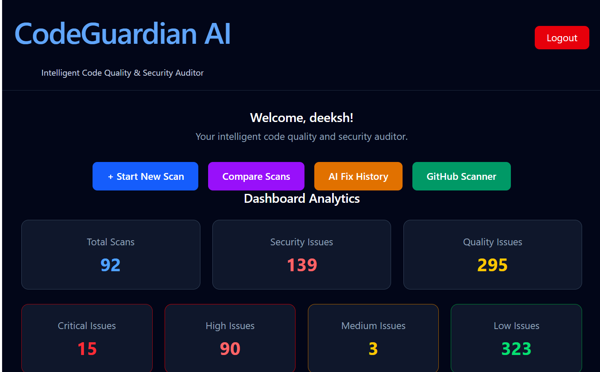
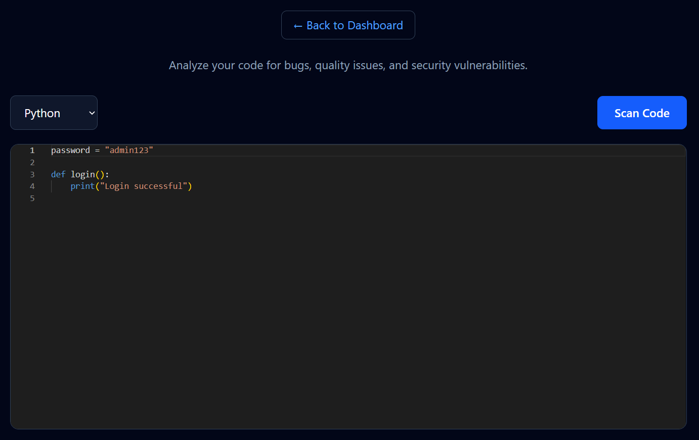
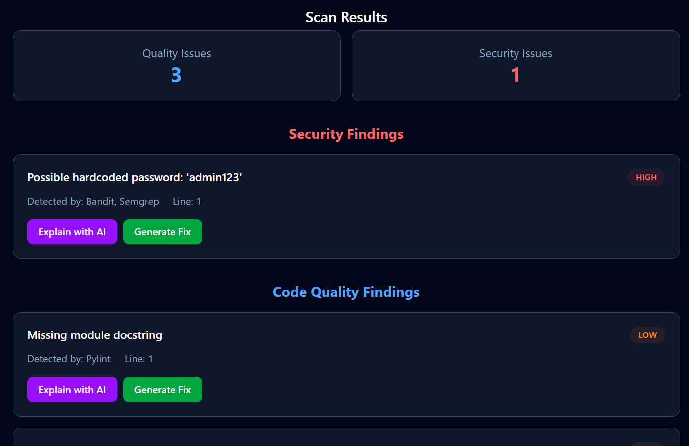
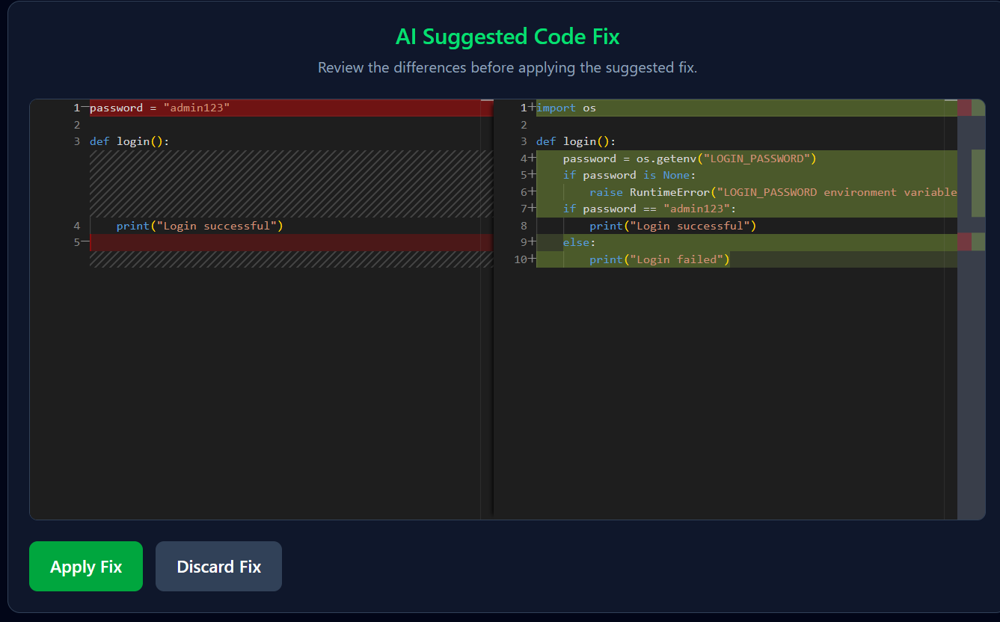
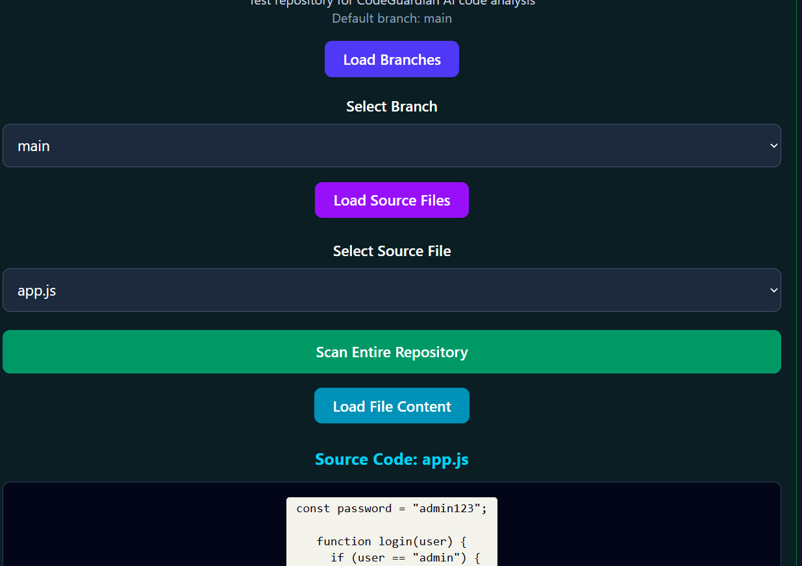
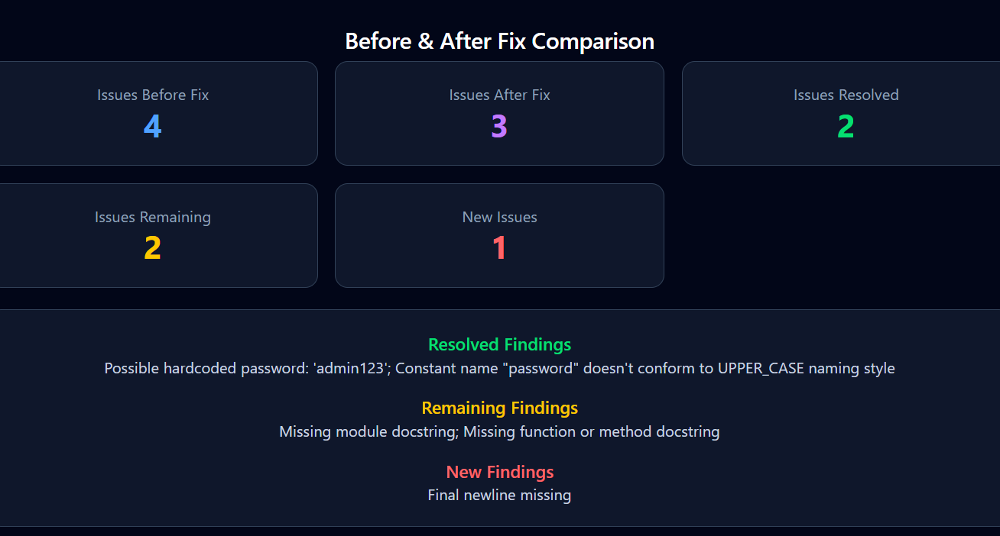

# CodeGuardian AI – Intelligent Code Quality & Security Auditor

CodeGuardian AI is an AI-powered code analysis platform designed to identify security vulnerabilities, detect code quality issues, explain findings, and suggest corrected code using AI.

## Features

- **Multi-language Analysis:** Supports Python and JavaScript.
- **Static Code Analysis:** Uses Pylint, ESLint, Bandit, and Semgrep.
- **Security Vulnerability Detection:** Detects issues such as hardcoded credentials, SQL injection, path traversal, unsafe eval, and XSS-related patterns.
- **AI-Powered Explanations:** Explains detected issues, their causes, security impact, and recommended fixes.
- **AI Code Fix Generation:** Generates corrected code suggestions.
- **Code Fix Review:** Compare original and suggested code using Monaco Diff Editor.
- **Scan History:** Stores and manages previous code analysis results.
- **Scan Comparison:** Compare analysis results between scans.
- **GitHub Repository Analysis:** Analyze individual files and supported files across public repositories.
- **Security and Quality Scores:** Provides scores to help understand code health.
- **PDF Reports:** Export code analysis reports.

## Technology Stack

| Component | Technologies |
|---|---|
| Frontend | React, Vite, Tailwind CSS |
| Code Editor | Monaco Editor |
| Backend | Node.js, Express.js |
| Database | MongoDB |
| AI Engine | Python, FastAPI |
| AI Models | Ollama, Qwen 2.5 Coder |
| Static Analysis | Pylint, ESLint, Bandit, Semgrep |
| Authentication | JWT, bcrypt |
| Version Control | Git, GitHub |

## Project Architecture

```text
CodeGuardian-AI/
│
├── frontend/
│   ├── src/
│   │   ├── components/
│   │   ├── context/
│   │   ├── pages/
│   │   └── services/
│   └── package.json
│
├── backend/
│   ├── config/
│   ├── controllers/
│   ├── middleware/
│   ├── models/
│   ├── routes/
│   ├── services/
│   └── server.js
│
├── ai-engine/
│   ├── analyzers/
│   ├── schemas/
│   ├── services/
│   ├── main.py
│   └── semgrep_rules.yml
│
└── README.md
```

## 📸 Project Screenshots

### 1. Dashboard


### 2. Code Scanning


### 3. Analysis Results


### 4. AI Code Fix


### 5. GitHub Scanner


### 6. Scan Comparison


## Local Setup

### Prerequisites

- Node.js and npm
- Python
- MongoDB Atlas account or MongoDB instance
- Ollama
- Git

### 1. Clone the repository

```bash
git clone https://github.com/YOUR_USERNAME/CodeGuardian-AI.git
cd CodeGuardian-AI
```

### 2. Configure environment variables

Create separate `.env` files for the backend, frontend, and AI engine using the configuration required by each service.

Never commit actual credentials, API secrets, database passwords, or JWT secrets.

### 3. Start the AI Engine

```bash
cd ai-engine
python -m uvicorn main:app --reload --port 8000
```

### 4. Start the Backend

Open another terminal:

```bash
cd backend
npm install
npm run dev
```

### 5. Start the Frontend

Open another terminal:

```bash
cd frontend
npm install
npm run dev
```

## AI Model Configuration

CodeGuardian AI uses locally hosted Ollama models for AI explanations and code-fix generation.

Configure the model names and Ollama URL in the AI engine environment variables.

## Security

- JWT-based authentication
- Password hashing using bcrypt
- Protected API routes
- User-specific scan and fix history
- Custom Semgrep security rules
- Environment-based secret configuration

## Project Status

Core code analysis, security scanning, AI explanations, AI-generated fixes, GitHub integration, scan history, and PDF reporting have been implemented and tested.

## Author

**Your Name**

GitHub: https://github.com/YOUR_USERNAME

---

*CodeGuardian AI – Write safer code. Detect vulnerabilities. Improve code quality.*
